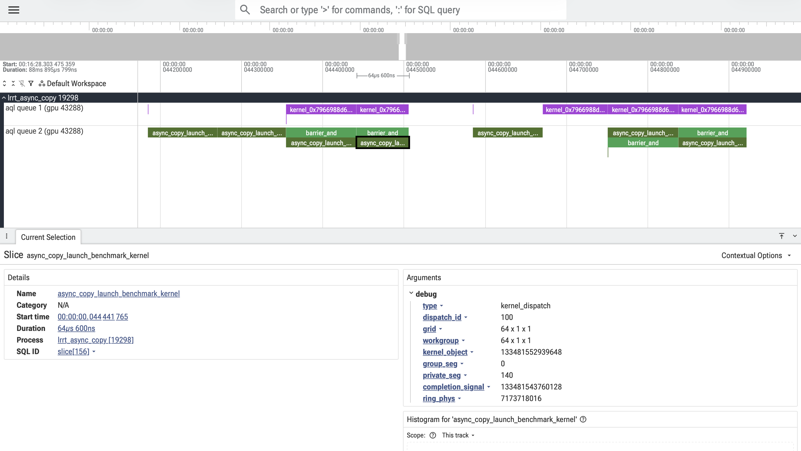

# hsa-snoop: A HIP/HSA-Agnostic AMD GPU Runtime Analyzer

[](https://github.com/sbates130272/hsa-snoop/actions/workflows/hsa-snoop-vm-hardware-test.yml)
[](https://github.com/sbates130272/hsa-snoop/actions/workflows/hsa-snoop-build-check.yml)
[](https://github.com/sbates130272/hsa-snoop/actions/workflows/hsa-snoop-clang-format.yml)
[](https://github.com/sbates130272/hsa-snoop/actions/workflows/hsa-snoop-spell-check.yml)
[](https://github.com/sbates130272/hsa-snoop/actions/workflows/hsa-snoop-debian-package.yml)
[](https://github.com/sbates130272/hsa-snoop/actions/workflows/hsa-snoop-debian-publish.yml)
[](https://github.com/sbates130272/hsa-snoop/actions/workflows/hsa-snoop-docs-deploy.yml)
[](https://sbates130272.github.io/hsa-snoop/perf/)
[](https://sbates130272.github.io/hsa-snoop/perf/)
[](https://sbates130272.github.io/hsa-snoop/perf/)
[](https://sbates130272.github.io/hsa-snoop/perf/)
[](https://github.com/sbates130272/hsa-snoop/actions/workflows/hsa-snoop-grafana-screenshot.yml)
[](https://github.com/sbates130272/hsa-snoop/blob/main/deploy/grafana/hsa-snoop-dashboard.json)
[](https://ui.perfetto.dev)

`hsa-snoop` traces AMD GPU workloads from user space — without touching the
driver. It discovers AQL compute queues and SDMA copy queues via a dynamic
kprobe, decodes all packet types including kernel dispatches and DMA copies,
and emits Perfetto traces with queue-observed timing, kernel names, byte counts
and directions.

```
sudo ./hsa-snoop -- ./my_hip_app     # launch + trace a single app
sudo ./hsa-snoop --all               # monitor every GPU process system-wide
# open traces at https://ui.perfetto.dev
```

Project pages: [GitHub Pages](https://sbates130272.github.io/hsa-snoop/) ·
[Performance tracker](https://sbates130272.github.io/hsa-snoop/perf/) ·
[Prometheus snapshot](https://sbates130272.github.io/hsa-snoop/prom/)

→ [How it works in detail](docs/internals.md)

## Perfetto trace visualization

`hsa-snoop` emits native Perfetto traces that can be opened in
[Perfetto UI](https://ui.perfetto.dev/). Each AQL or SDMA queue gets its own
timeline track; selecting a slice exposes decoded metadata including grid
dimensions, kernel object, segment sizes and completion signals.

<table>
  <tr>
    <td width="50%">
      <a href="docs/images/perfetto-trace-overview.png">
        
      </a>
    </td>
    <td width="50%">
      <a href="docs/images/perfetto-dispatch-detail.png">
        
      </a>
    </td>
  </tr>
  <tr>
    <td align="center">
      <sub>Full trace showing packet activity across two AQL queues.</sub>
    </td>
    <td align="center">
      <sub>Kernel dispatches and barrier packets, with decoded dispatch metadata.</sub>
    </td>
  </tr>
</table>

> [!NOTE]
> Slices represent approximate enqueue-to-queue-consumed residency, not GPU
> execution time.

---

## Build

```
cmake -B build
cmake --build build --parallel $(nproc)
```

Requires a C++17 compiler and CMake 3.21+. No third-party libraries. `protoc`
is optional. If ROCm is installed, the HIP examples under `deploy/examples/`
are built automatically; pass `-DGPU_TARGETS=gfxNNNN` to override detection.

### Tests

```
cmake -B build -DBUILD_TESTING=ON
cmake --build build --parallel $(nproc)
ctest --test-dir build --output-on-failure
```

Hardware tests (require a GPU and root):

```
cmake -B build-hw -DBUILD_TESTING=ON -DHSA_SNOOP_HARDWARE_TESTS=ON
cmake --build build-hw --parallel $(nproc)
sudo ctest --test-dir build-hw -L hardware --output-on-failure
```

### Prometheus exporter build

```
cmake -B build -DHSA_SNOOP_PROMETHEUS=ON
cmake --build build --parallel $(nproc)
```

Fetches [prometheus-cpp](https://github.com/jupp0r/prometheus-cpp) v1.2.4 via
`FetchContent`; no other dependencies required.

---

## Usage

Must run as root (tracefs, pagemap and cross-process reads all require it).

```
sudo ./hsa-snoop [options] --pid <pid>       # attach to a running process
sudo ./hsa-snoop [options] -- <command...>   # launch and trace a command
sudo ./hsa-snoop [options] --all             # monitor all GPU processes

Options:
  --pid <pid>        Trace only this process
  --all              Monitor all HSA/HIP processes system-wide
  --out <file>       Output trace path (default hsa-snoop.pftrace / .json)
  --out-dir <dir>    Output directory for --all mode (default /var/log/hsa-snoop)
  --format <fmt>     perfetto (default) | json
  --poll-us <n>      Ring poll interval in microseconds (default 20)
  --duration <sec>   Auto-stop after N seconds (0 = until Ctrl-C / child exit)
  --tracefs <path>   tracefs mount (default /sys/kernel/tracing)
  --mode <mode>      kprobe (default) | bpftrace | kfd-uprobe
  --librocdxg <path> Path to librocdxg.so.* (bpftrace mode; auto-detected)
  --libhsa <path>    Path to libhsa-runtime64.so.* (kfd-uprobe mode; auto-detected)
  --ais-snoop        Monitor AMD Infinity Storage P2P DMA ioctls
  --log-dispatches <file>
                     Write one NDJSON line per event to <file> (use '-' for stderr)
  --prometheus       Expose metrics via Prometheus HTTP endpoint
  --prometheus-port <n>
                     Prometheus /metrics port (default 9488)
  --prometheus-snapshot <file>
                     Write Prometheus text snapshot to <file> on exit
  --xnack-snoop      Count GPU page-fault retry (XNACK) events
```

**Launch mode** (recommended — kprobe armed before exec, captures all queues):

```
sudo ./hsa-snoop -- ./my_hip_app
```

**System-wide mode** (daemon; one trace file per queue under `--out-dir`):

```
sudo ./hsa-snoop --all
```

**WSL2** (auto-detected; uses bpftrace uprobe on librocdxg instead of KFD):

```
sudo ./hsa-snoop -- ./my_hip_app
```

**Emulated GPU / kfd-uprobe** (safe on rocjitsu/vfio-user; no `process_vm_readv`):

```
sudo ./hsa-snoop --mode kfd-uprobe --all --prometheus
```

→ [Full per-mode details, systemd setup, dispatch log](docs/usage.md)

---

## Prometheus exporter

When built with `-DHSA_SNOOP_PROMETHEUS=ON`:

```
sudo ./hsa-snoop --all --prometheus                  # serve on default port 9488
sudo ./hsa-snoop --all --prometheus-port 9100        # custom port
curl http://localhost:9488/metrics
```

Metrics exposed (all carry constant labels `host`, `platform`, `rocm_version`,
`discovery_mode`):

| Metric | Type | Labels | Description |
| --- | --- | --- | --- |
| `hsa_snoop_up` | Gauge | — | 1 when the exporter is running |
| `hsa_kernel_launches_total` | Counter | `kernel_name`, `gpu_id`, `gpu_type`, `pid`, `comm` | Kernel dispatch count |
| `hsa_kernel_duration_seconds` | Histogram | `kernel_name`, `gpu_id`, `gpu_type` | Kernel duration (host-observed, enqueue to queue-consumed) |
| `hsa_kernel_launches_per_second` | Gauge | `gpu_id`, `gpu_type` | Rolling 10 s launch rate |
| `hsa_last_kernel_launch_timestamp_seconds` | Gauge | `gpu_id`, `gpu_type` | Wall-clock time of most recent launch |
| `hsa_last_kernel_launch_info` | Gauge | `gpu_id`, `gpu_type`, `kernel_name` | Most recently launched kernel name (value always 1) |
| `hsa_active_queues` | Gauge | `gpu_id`, `gpu_type` | Currently tracked AQL queues |
| `hsa_barrier_packets_total` | Counter | `gpu_id`, `gpu_type`, `pid`, `comm` | Barrier AQL packets seen |
| `hsa_sdma_copies_total` | Counter | `gpu_id`, `gpu_type`, `pid`, `comm`, `direction` | SDMA copy packets, by direction (`h2d`/`d2h`/`d2d`) |
| `hsa_sdma_bytes_total` | Counter | `gpu_id`, `gpu_type`, `pid`, `comm`, `direction` | Bytes moved by SDMA copies |
| `hsa_sdma_packets_total` | Counter | `gpu_id`, `gpu_type`, `pid`, `comm`, `opcode` | SDMA packets by opcode |
| `hsa_active_sdma_queues` | Gauge | `gpu_id`, `gpu_type` | Currently tracked SDMA queues |
| `hsa_sdma_present` | Gauge | — | 1 when first SDMA queue seen; 0 on APU/unified-memory nodes |
| `hsa_triggered` | Gauge | `gpu_id`, `gpu_type` | 1 on first kernel dispatch on this GPU |
| `hsa_errors_total` | Counter | `gpu_id`, `pid` | Packets before queue registration |
| `hsa_xnack_total` | Counter | `pasid`, `comm` | GPU page-fault retries (`--xnack-snoop`) |

AIS metrics (all require `--ais-snoop`; labels: `gpu_id`, `gpu_type`, `pcie_id`,
`device_type`, `vendor`):

| Metric | Type | Description |
| --- | --- | --- |
| `ais_snoop_armed` | Gauge | 1 if AIS kprobe started; absent if `--ais-snoop` not passed |
| `ais_active` | Gauge | 1 on first AIS operation |
| `ais_rx_ops_total` / `ais_tx_ops_total` | Counter | AIS ioctls completed |
| `ais_rx_bytes_total` / `ais_tx_bytes_total` | Counter | P2P DMA bytes transferred |
| `ais_rx_errors_total` / `ais_tx_errors_total` | Counter | Failed operations (extra `errno` label) |
| `ais_rx_latency_seconds` / `ais_tx_latency_seconds` | Histogram | ioctl entry-to-return latency |
| `ais_rx_io_size_bytes` / `ais_tx_io_size_bytes` | Histogram | Requested transfer size |
| `ais_pcie_device_info` | Gauge | Info metric per PCIe device |

---

## Grafana dashboard

[](https://github.com/sbates130272/hsa-snoop/blob/main/deploy/grafana/hsa-snoop-dashboard.json)

> Screenshot updated automatically by the `grafana-screenshot` CI workflow.
> Import `deploy/grafana/hsa-snoop-dashboard.json` via **Dashboards → Import**.

The dashboard reads from two datasources: **Prometheus** (Overview, Throughput,
Duration, Queue, SDMA, AIS — requires `--prometheus`) and **Loki** (Kernel
Launch Timeline — requires `--log-dispatches` shipped into Loki). The Prometheus
rows work standalone; Loki rows stay empty without a log pipeline.

→ [Dashboard development workflow (capture-then-replay)](docs/usage.md#grafana-dashboard-development)

---

## Layout

```
src/aql.{h,cpp}                    AQL packet formats (mirrors <hsa/hsa.h>)
src/sdma.{h,cpp}                   SDMA microcode packet formats + length decode
src/model.h                        QueueInfo / PacketRecord / SdmaRecord data model
src/discovery.{h,cpp}              queue discovery: kprobe (native), bpftrace (WSL2/librocdxg), kfd-uprobe (emulated GPU)
src/proc_mem.{h,cpp}               process_vm_readv + pagemap (VA->phys)
src/ksym.{h,cpp}                   kernel_object -> demangled name via code-object ELFs
src/parser.{h,cpp}                 per-queue ring poller / AQL + SDMA decoder / timing
src/trace_writer.{h,cpp}           Perfetto protobuf + Chrome JSON writers
src/prometheus_exporter.{h,cpp}    Prometheus metrics exporter (optional)
src/dispatch_log.{h,cpp}           NDJSON per-event log (--log-dispatches)
src/main.cpp                       CLI / orchestration
scripts/hsa-snoop.bt               zero-build discovery via bpftrace
scripts/slurm/                     multi-GFX Slurm validation + capture harness
scripts/observability/             offline Grafana/Prometheus/Loki replay stack
deploy/grafana/hsa-snoop-dashboard.json   reference Grafana dashboard
deploy/systemd/hsa-snoop-prometheus.service  systemd unit (Prometheus exporter daemon)
deploy/systemd/hsa-snoop.conf             runtime configuration (extra ExecStart arguments)
```

---

## Further reading

- [How it works, SDMA capture, driver details](docs/internals.md)
- [All usage modes, systemd setup, dispatch log](docs/usage.md)
- [Limitations and notes](docs/limitations.md)
