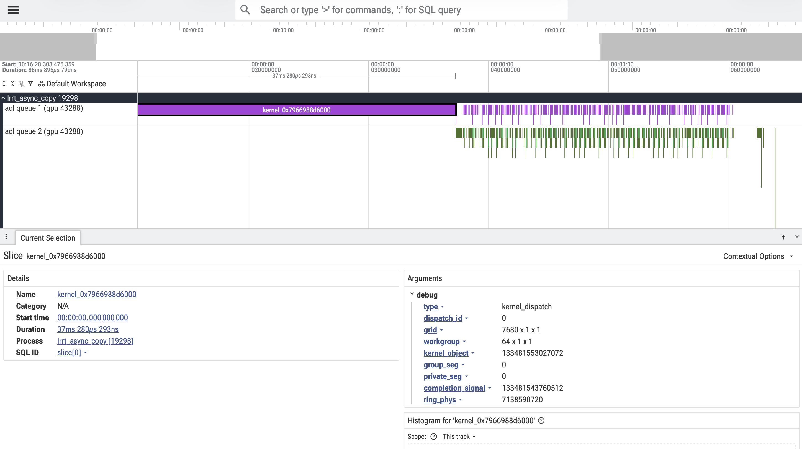

# hsa-snoop

`hsa-snoop` traces AMD GPU workloads from user space, without touching
the driver. It discovers AQL compute queues and SDMA copy queues via a
dynamic kprobe, decodes every packet type including kernel dispatches
and DMA copies, and emits Perfetto traces with queue-observed timing,
kernel names, byte counts and directions.

```
sudo ./hsa-snoop -- ./my_hip_app     # launch + trace a single app
sudo ./hsa-snoop --all               # monitor every GPU process system-wide
# open traces at https://ui.perfetto.dev
```

[](perfetto.md)

## Tracked Performance

[](perf/index.md)
[](perf/index.md)
[](perf/index.md)
[](perf/index.md)

Every hardware-test run on `main` records these counters. The
[performance tracker](perf/index.md) charts them per run, and the
[Prometheus snapshot](prom/index.md) lists every metric the latest run
exported.

## Where To Start

<div class="grid cards" markdown>

-   __Trace Queue Activity__

    The [usage guide](usage.md) covers every capture mode, the systemd
    unit and the dispatch log. [Perfetto traces](perfetto.md) shows what
    the output looks like.

-   __Export Live Metrics__

    The [Prometheus exporter](prometheus.md) publishes kernel launches,
    SDMA copies and AIS storage traffic during a capture, and the
    [Grafana dashboard](grafana.md) reads them.

-   __Track Regressions__

    The [performance tracker](perf/index.md) charts the key counters
    from every CI run against an emulated GPU.

-   __Understand The Internals__

    [How it works](internals.md) covers queue discovery, ring polling
    and SDMA decoding. See also the [project layout](layout.md) and the
    [limitations](limitations.md).

</div>

## Building

```
cmake -B build
cmake --build build --parallel $(nproc)
```

Requires a C++17 compiler and CMake 3.21+. No third-party libraries.
Add `-DHSA_SNOOP_PROMETHEUS=ON` for the Prometheus exporter. The
[repository](https://github.com/sbates130272/hsa-snoop#building) covers
testing and the HIP examples.
