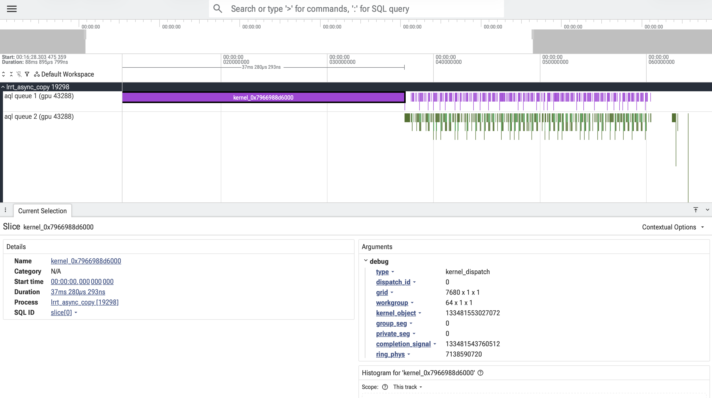

# Perfetto Trace Visualization

`hsa-snoop` emits native Perfetto traces that can be opened in
[Perfetto UI](https://ui.perfetto.dev/). Each AQL or SDMA queue gets its own
timeline track; selecting a slice exposes decoded metadata including grid
dimensions, kernel object, segment sizes and completion signals.

<table>
  <tr>
    <td width="50%">
      
    </td>
    <td width="50%">
      
    </td>
  </tr>
  <tr>
    <td align="center">
      Full trace showing packet activity across two AQL queues.
    </td>
    <td align="center">
      Kernel dispatches and barrier packets, with decoded dispatch metadata.
    </td>
  </tr>
</table>

> [!NOTE]
> `hsa-snoop` slices represent approximate enqueue-to-queue-consumed residency,
> not GPU execution time.

Output format is native Perfetto protobuf (`.pftrace`, default) or Chrome JSON
(`--format json`); both open in <https://ui.perfetto.dev>.
