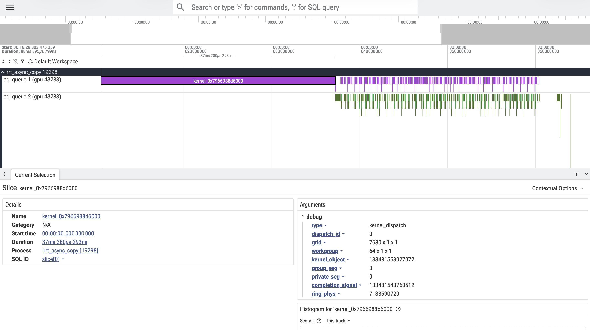
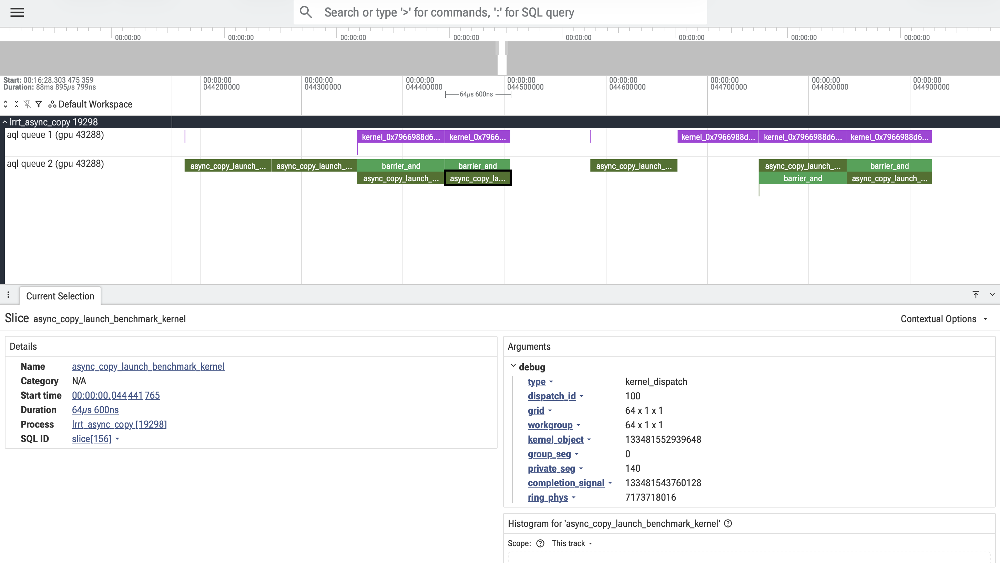

# Perfetto Trace Visualization

`hsa-snoop` emits native Perfetto traces that can be opened in
[Perfetto UI](https://ui.perfetto.dev/). Each AQL or SDMA queue gets its own
timeline track; selecting a slice exposes decoded metadata including grid
dimensions, kernel object, segment sizes and completion signals.

| Full trace showing packet activity across two AQL queues | Kernel dispatches and barrier packets, with decoded dispatch metadata |
| --- | --- |
|  |  |

> **Note:** `hsa-snoop` slices represent approximate enqueue-to-queue-consumed residency,
> not GPU execution time.

Output format is native Perfetto protobuf (`.pftrace`, default) or Chrome JSON
(`--format json`); both open in <https://ui.perfetto.dev>.
